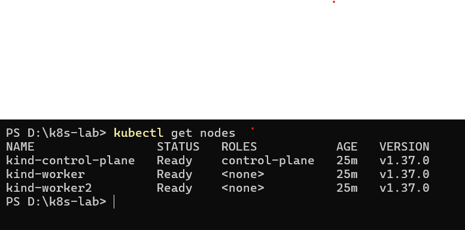
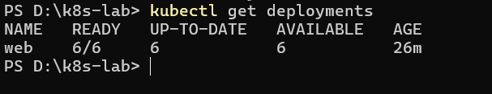
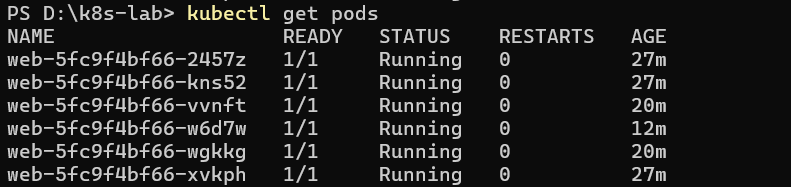

\# Kubernetes Lab on Windows


Build and manage a local three-node Kubernetes cluster on Windows using Docker Desktop, kind, and kubectl. Deploy NGINX, scale replicas, and demonstrate Kubernetes self-healing.


\## Overview


This lab demonstrates how to create a local Kubernetes cluster, deploy a web application, scale workloads, and observe automatic recovery when a Pod is deleted.


\## Technology Stack


\- Windows 10/11

\- WSL 2 with Ubuntu

\- Docker Desktop

\- Kubernetes CLI (`kubectl`)

\- kind (Kubernetes IN Docker)

\- NGINX


\## Architecture


\- \*\*1 Control Plane Node:\*\* Manages cluster operations.

\- \*\*2 Worker Nodes:\*\* Run application workloads.

\- \*\*NGINX Deployment:\*\* Maintains the desired number of application replicas.


\## Project Structure


```text

kubernetes-lab-windows/

├── README.md

├── kind-config.yaml

└── screenshots/

&#x20;   ├── nodes-ready.png

&#x20;   ├── nginx-deployment.png

&#x20;   └── self-healing.png

```


\## Step 1: Verify Tools


```powershell

wsl --status

docker version

kubectl version --client

kind version

```


\## Step 2: Create the Cluster


The cluster configuration in `kind-config.yaml`:


```yaml

kind: Cluster

apiVersion: kind.x-k8s.io/v1alpha4

nodes:

&#x20; - role: control-plane

&#x20; - role: worker

&#x20; - role: worker

```


Create the cluster:


```powershell

kind create cluster --config kind-config.yaml

```


Verify the cluster:


```powershell

kubectl cluster-info --context kind-kind

kubectl get nodes

docker ps

kubectl get pods -n kube-system -o wide

```


\## Step 3: Deploy NGINX


Create a Deployment with three replicas:


```powershell

kubectl create deployment web --image=nginx --replicas=3

```


Inspect the Deployment and Pods:


```powershell

kubectl get deployments

kubectl get pods -o wide

kubectl describe pod <pod-name>

```


Wait until all three replicas are ready.


\## Step 4: Scale the Deployment


Scale the NGINX Deployment from three to six replicas:


```powershell

kubectl scale deployment web --replicas=6

```


Verify the replicas:


```powershell

kubectl get deployments

kubectl get pods -o wide

kubectl get pods -w

```


Wait until all six Pods are Running and Ready.


\## Step 5: Test Self-Healing


Delete one Pod using its actual name:


```powershell

kubectl delete pod <pod-name>

```


Observe the replacement:


```powershell

kubectl get pods -w

```


Kubernetes automatically creates a replacement Pod to restore the desired replica count.


\## Results


The lab was completed successfully.


\- Created a three-node Kubernetes cluster with one control-plane node and two worker nodes.

\- Verified that all three nodes reached the Ready state.

\- Deployed three NGINX replicas successfully.

\- Scaled the Deployment from three to six replicas.

\- Deleted one Pod and observed Kubernetes create a replacement.

\- Verified the final Deployment status: \*\*6/6 Ready, 6 up-to-date, and 6 available\*\*.


## Screenshots

### Kubernetes Cluster


### NGINX Deployment


### Kubernetes Self-Healing



\## Key Concepts Learned


\- Kubernetes clusters and nodes

\- Deployments and ReplicaSets

\- Pods and container orchestration

\- Replica scaling

\- Kubernetes scheduling

\- Self-healing and desired state management


\## Conclusion


This lab demonstrated the fundamental Kubernetes workflow on a Windows laptop using kind and Docker Desktop. The successful scaling and Pod replacement experiments demonstrated Kubernetes workload management and self-healing.


\## Author


Add your name and GitHub profile here.


